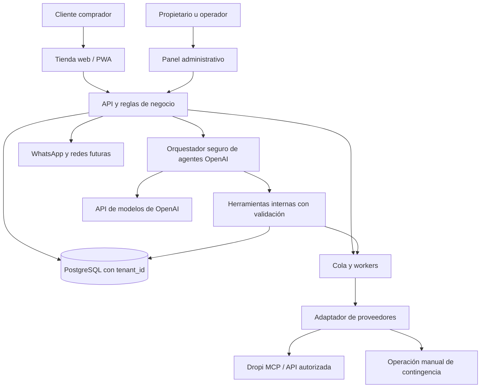
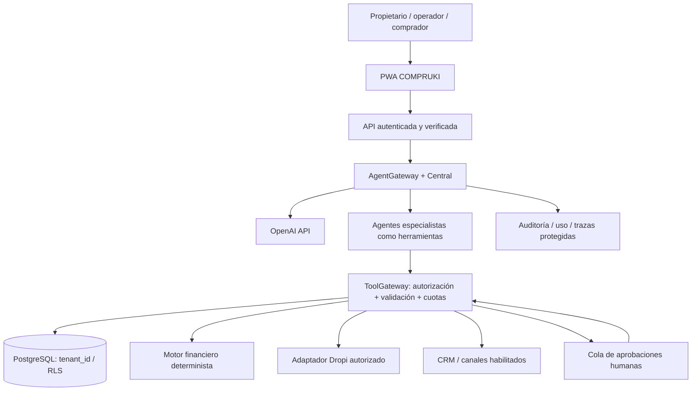

# DOCUMENTO MAESTRO — COMPRUKI | COMERCIO INTELIGENTE Y AUTOMATIZACIÓN DE VENTAS

**Versión:** 1.2  
**Fecha:** 4 de noviembre de 2026  
**Mercado inicial:** Colombia  
**Marca / nombre de trabajo:** COMPRUKI (provisional; sujeto a validación legal y comercial)  
**Color principal aprobado para diseño:** `#222638` (grafito azulado)  
**Eslogan de trabajo:** «Tu negocio, en modo venta.» (provisional)  
**Estado:** documento vivo de planificación; capa de agentes OpenAI incorporada en diseño, aún no implementada; integración Dropi y disponibilidad marcaria pendientes de validación

## 1. Resumen ejecutivo

Diseñar y desarrollar **COMPRUKI**, una plataforma web progresiva (PWA) que inicialmente permita operar una tienda propia con productos de Dropi: selección y publicación de productos, cálculo de precios, catálogo y carrito, captura de pedidos, seguimiento y reportes. Su arquitectura deberá permitir habilitar posteriormente múltiples tiendas independientes bajo suscripción (SaaS), herramientas de inteligencia artificial, campañas digitales, redes sociales, CRM y WhatsApp. **A partir de la versión 1.2 se incorpora el subsistema de agentes de OpenAI:** diez roles funcionales planificados, implementados gradualmente sobre un orquestador, herramientas autorizadas y procesos revisables.

**Regla de producto:** lanzar una operación comercial pequeña, medible y segura. Se permite un piloto acotado de agentes de consulta, análisis y borradores sin que estos sean una dependencia del flujo de compra; las acciones externas, automatizaciones complejas y cobro SaaS se activan gradualmente. La marca COMPRUKI y el eslogan se consideran provisionales; podrán cambiarse posteriormente sin rehacer la base técnica.

## 2. Marca e identidad visual (versión provisional aprobada para prototipos)

### 2.1 Nombre, propósito y posicionamiento

- **Nombre de trabajo:** **COMPRUKI** (usar siempre esta grafía en el panel, la tienda piloto y la documentación; no es todavía una marca registrada ni se considera nombre disponible jurídicamente).
- **Pronunciación deseada:** «com-pru-ki», amigable y fácil de recordar para el público latinoamericano.
- **Categoría de marca:** plataforma de comercio electrónico, gestión de tiendas, automatización de ventas e inteligencia artificial aplicada al comercio.
- **Promesa de producto:** reunir catálogo, tienda, pedidos y, progresivamente, publicidad e IA en una experiencia simple para emprendedores.
- **Posicionamiento:** una herramienta cercana y moderna para vender con mayor organización; evitar promesas absolutas de ganancias o ventas automáticas garantizadas.
- **Eslogan de trabajo:** **«Tu negocio, en modo venta.»** No se ha aprobado de forma irrevocable y está sujeto a revisión marcaria/comercial.
- **Tono de comunicación:** latino, claro, juvenil, optimista, profesional y sin tecnicismos innecesarios; comunicación inclusiva y honesta.

**Gobierno de marca:** el nombre, colores, logo y eslogan son configuraciones de presentación, no identificadores técnicos inmutables. No incluir “COMPRUKI” como clave obligatoria en IDs, tablas, reglas de negocio, rutas críticas ni identificadores de tenants. El sistema debe permitir una sustitución futura de identidad sin migración destructiva de datos.

### 2.2 Paleta cromática oficial de trabajo

Color central solicitado: **`#222638`** — grafito azulado profundo. Transmite seguridad, seriedad y tecnología sin perder una estética moderna. La gama complementaria añade energía comercial e innovación, sin recargar la pantalla.

| Rol / token | Nombre de color | Hexadecimal | Aplicación |
|---|---|---|---|
| `brand.primary` | Grafito azulado | **`#222638`** | Identidad base, cabeceras, barras laterales, botones principales y títulos |
| `brand.primary-dark` | Noche profunda | `#171A28` | Estados presionados, fondos oscuros y piezas especiales |
| `brand.primary-soft` | Pizarra azul | `#39415C` | Navegación secundaria, tarjetas oscuras, estados hover |
| `brand.slate` | Gris azulado | `#59657A` | Texto secundario y elementos de apoyo sobre fondo claro |
| `brand.accent` | Turquesa vivo | **`#25C7A5`** | Detalles de innovación, indicadores, ilustraciones y acentos visuales |
| `brand.accent-strong` | Verde petróleo | `#087D70` | Botones alternativos y enlaces con texto blanco o sobre fondos claros |
| `brand.accent-tint` | Menta muy claro | `#EAF9F5` | Fondos de mensajes positivos y paneles relacionados con IA |
| `brand.coral` | Coral cálido | **`#FF8A65`** | Promociones, destacados comerciales y campañas; uso moderado |
| `brand.coral-strong` | Terracota | `#B74F35` | Texto/acciones promocionales accesibles |
| `brand.coral-tint` | Coral pálido | `#FFF1EC` | Etiquetas y avisos promocionales suaves |
| `surface.canvas` | Blanco humo | **`#F6F8FC`** | Fondo general del dashboard y espacios de trabajo |
| `surface.card` | Blanco puro | `#FFFFFF` | Tarjetas, formularios, superficies elevadas y tienda |
| `surface.subtle` | Gris nube | `#EDF0F6` | Secciones diferenciadas, campos inactivos y divisores suaves |
| `border.default` | Gris hielo | `#DDE3ED` | Bordes, separadores y cuadros de entrada |
| `text.primary` | Grafito azulado | **`#222638`** | Texto principal sobre fondos claros |
| `text.secondary` | Gris azulado | `#59657A` | Descripciones, ayudas y metadatos |
| `text.on-dark` | Blanco | `#FFFFFF` | Texto sobre fondos grafito/pizarra y botones oscuros |

**Balance visual:** en el panel administrativo priorizar superficies claras (aprox. 70–80 %), grafito/pizarra (15–20 %) y turquesa/coral como acentos puntuales (5–10 %). Estas proporciones son orientativas, no una regla matemática. La tienda pública puede usar imágenes de producto con mayor peso visual.

### 2.3 Legibilidad, contraste y accesibilidad

- Contraste de referencia calculado: `#FFFFFF` sobre `#222638` ≈ **14.97:1**; `#FFFFFF` sobre `#087D70` ≈ **5.03:1**; `#59657A` sobre `#FFFFFF` ≈ **5.89:1**.
- **No usar texto blanco pequeño sobre `#25C7A5` o `#FF8A65`**, porque el contraste es insuficiente para texto normal. Sobre estos acentos usar `#222638` (contraste aprox. 6.98:1 y 6.47:1, respectivamente) o sus variantes oscuras como fondo de botón con texto blanco.
- Mantener contraste mínimo objetivo WCAG AA de 4.5:1 en texto normal y 3:1 en texto grande/elementos relevantes, según la naturaleza del componente.
- No comunicar un estado exclusivamente por color: acompañarlo de texto, ícono o patrón (p. ej., “Entregado”, “Pendiente”, “Error”). Probar teclado, foco visible, tamaños móviles y lector de pantalla.
- Colores de éxito, advertencia y error son **tokens semánticos distintos**, no se confunden con el color coral promocional. Validar su contraste antes de consolidar el sistema de diseño.

### 2.4 Tipografía, estilo y componentes

- **Tipografía propuesta:** *Plus Jakarta Sans* para títulos e interfaz, con fallback `Inter, system-ui, sans-serif`. Puede cambiarse antes del lanzamiento sin tocar el modelo de datos.
- **Estilo:** formas amables, esquinas redondeadas de 10–16 px, espaciado generoso, iconografía lineal consistente, componentes táctiles cómodos.
- **Botón principal:** fondo `#222638` / texto `#FFFFFF`; hover `#39415C` / texto blanco; foco visible de alto contraste.
- **Botón de acción destacada:** fondo `#087D70` / texto blanco; usar para activar/publicar funciones cuando corresponda.
- **Etiquetas de promoción:** fondo `#FFF1EC` / texto `#B74F35`; fondos turquesa claro con texto petróleo para avisos de IA.
- **Panel:** barra lateral grafito, encabezados claros, tarjetas blancas y métricas con acentos discretos; evitar saturar el dashboard con grandes bloques coral o turquesa.
- **Tienda:** identidad visual COMPRUKI en cabecera y pie, fichas de producto limpias, botones de compra de alta visibilidad y precio con jerarquía clara; imágenes reales y autorizadas.
- **PWA:** definir íconos y splash en variantes sobre grafito y sobre blanco. El logotipo/isotipo definitivo se diseñará después de verificar la disponibilidad del nombre.

### 2.5 Variables CSS propuestas (base del sistema de diseño)

```css
:root {
  --brand-primary: #222638;
  --brand-primary-dark: #171A28;
  --brand-primary-soft: #39415C;
  --brand-slate: #59657A;
  --brand-accent: #25C7A5;
  --brand-accent-strong: #087D70;
  --brand-accent-tint: #EAF9F5;
  --brand-coral: #FF8A65;
  --brand-coral-strong: #B74F35;
  --brand-coral-tint: #FFF1EC;
  --surface-canvas: #F6F8FC;
  --surface-card: #FFFFFF;
  --surface-subtle: #EDF0F6;
  --border-default: #DDE3ED;
  --text-primary: #222638;
  --text-secondary: #59657A;
  --text-on-dark: #FFFFFF;
}
```

Estas variables se centralizarán en el tema de Tailwind/design tokens para evitar colores escritos manualmente en cada pantalla. Preparar soporte futuro para modo oscuro mediante un segundo conjunto de tokens semánticos (sin limitarse a invertir colores).

### 2.6 Nomenclatura y verificación de marca

- Utilizar **COMPRUKI** únicamente como **nombre provisional de trabajo** durante desarrollo y prototipos.
- Existe un nombre **COMPRAKI** visual y fonéticamente parecido, con antecedentes de uso comercial. Esto **no demuestra** que exista un derecho vigente que impida COMPRUKI, pero exige evaluación de confundibilidad antes de usarlo públicamente.
- Verificar en **SIPI/SIC Colombia**, **OMPI**, **RUES**, buscadores, tiendas de apps, perfiles sociales y registro efectivo de dominios (`compruki.com`, `compruki.co`, variantes relevantes), incluyendo marcas similares, no solo coincidencia exacta.
- Analizar prioritariamente las clases **35** (servicios comerciales y publicidad) y **42** (software/SaaS); estudiar **9** si posteriormente hay software descargable. Validación definitiva: búsqueda formal y, cuando corresponda, asesoría marcaria.
- **No afirmar dominio o registro disponible** solo porque no aparezca una página web. El MVP puede desplegarse en un dominio técnico temporal hasta resolver la marca.
- Si cambia el nombre, modificar configuración de marca, identidad gráfica, metadatos SEO, dominio, textos, manifest PWA y documentación; **no** migrar identidades internas de pedidos, clientes o tenants por razones de marca.

## 3. Visión y objetivos

- Centralizar la venta digital y la operación de pedidos en un solo panel.
- Reducir tareas manuales del comerciante, sin sacrificar control de precios, publicidad y despacho.
- Incorporar agentes OpenAI especializados que colaboren con el comerciante y entre sí, con herramientas limitadas, validaciones deterministas y aprobación humana para acciones externas sensibles.
- Medir margen por pedido y costos asociados a la venta.
- Preparar una infraestructura multiempresa desde el inicio para escalar a SaaS.
- Mantener independencia tecnológica frente a cambios de integraciones de Dropi y de redes sociales.

### 3.1 Indicadores de éxito

- Primer pedido real registrado con trazabilidad de principio a fin.
- Porcentaje de pedidos enviados satisfactoriamente a Dropi, sin duplicaciones.
- Tiempo de actualización del estado de pedidos.
- Margen estimado frente a margen realizado por pedido.
- Conversiones de visitas a pedidos, cuando exista tráfico suficiente.
- Errores operativos y de conciliación medidos y registrados.
- Para IA: tasa de respuestas fundamentadas, borradores aprobados, incidencias por agente, escalamiento humano y costo por tarea/tenant.

## 4. Modelo de negocio

### 4.1 Etapa inicial: negocio propio

La plataforma administra una tienda y su operación en Colombia. No se cobra a usuarios externos.

### 4.2 Etapa futura: SaaS

Cada comerciante podrá tener una organización o tenant, una o varias tiendas según el plan, usuarios con roles, integración individual y autorizada con Dropi, catálogos, clientes y pedidos aislados. Los planes, precios, facturación recurrente, límites y períodos de prueba se definirán después de validar el MVP. No se fijan tarifas de suscripción sin validar costos y mercado.

### 4.3 Límites legales y comerciales

No se presume permiso de Dropi para redistribuir su catálogo a múltiples comerciantes ni para explotar una integración como servicio SaaS. Es requisito confirmar acuerdos, políticas y alcance de permisos. Deben revisarse protección de datos personales en Colombia, derechos del consumidor, publicidad, tratamiento de datos en mensajería y obligaciones comerciales antes de salir a producción.

## 5. Personas y roles

1. **Superadministrador de la plataforma:** gestiona seguridad, incidentes, planes futuros, auditoría y tenants.
2. **Propietario del comercio:** configura tienda, productos, márgenes e integraciones, aprueba pedidos y consulta reportes.
3. **Operador comercial:** revisa pedidos y clientes según sus permisos.
4. **Cliente comprador:** navega el catálogo y realiza un pedido; cuenta opcional en el MVP.
5. **SaaS futuro:** administrador y colaboradores de cada tenant con permisos granulares.

## 6. Alcance del MVP (P0)

### 6.1 Identidad y organización

- Inicio de sesión seguro y recuperación de acceso.
- Tenant propio y usuarios con roles; soporte lógico multitenant desde el diseño.
- Panel privado y permisos por rol.

### 6.2 Catálogo

- Alta manual de productos y carga desde integración Dropi, condicionada a permisos.
- SKU interno y referencia externa de proveedor; nombre, imágenes con derechos de uso, descripción, variantes, estado, precio y costo registrado.
- Activación y desactivación de publicación; control explícito de productos no disponibles.
- Costos, tarifas y precio de venta configurables; histórico de cambios de precio.

### 6.3 Tienda pública

- Página principal, categorías, búsqueda, fichas de producto y carrito.
- Checkout con información mínima necesaria del comprador, dirección y aceptación de políticas.
- Vista responsive/PWA, optimización básica SEO, accesibilidad y buen rendimiento móvil.
- Confirmación de pedido, sin prometer disponibilidad definitiva ni fecha exacta no verificada.

### 6.4 Pedidos

- Estados internos: borrador, pendiente de confirmación, confirmado, en sincronización, enviado a proveedor, en preparación, en transporte, entregado, cancelado, devuelto e incidencia.
- Identificador interno y external_order_id separados, historial de cambios, usuario/servicio responsable y trazas de eventos.
- Envío manual autorizado como contingencia si la integración falla.
- Idempotencia y prevención de envío duplicado a Dropi.
- Consulta de estado desde Dropi cuando esté permitido; sincronización periódica o webhooks solo si se confirman oficialmente.

### 6.5 Gestión financiera básica

- Coste del producto, flete estimado/real, costos de recaudo y comisiones registradas, precio vendido, gasto publicitario atribuible cuando exista.
- **Margen estimado** = precio de venta - costo de producto - envío - comisiones - otros costos estimados.
- **Utilidad realizada** solo cuando se conozcan efectivamente pagos, devoluciones y gastos.
- Las métricas deben diferenciar pedidos registrados, confirmados, entregados y efectivamente cobrados.

### 6.6 Panel de control

- Pedidos por estado y ventas confirmadas, entregadas y cobradas por separado.
- Ventas y márgenes por producto y período.
- Incidencias de integración y pedidos pendientes de atención.

### 6.7 Piloto opcional de agentes asistivos (P0-IA; no bloquea salida del MVP)

- Activar **COMPRUKI Central** como punto único de consulta para el propietario, con herramientas de **solo lectura** inicialmente.
- Habilitar el **Explorador de Productos** únicamente sobre catálogo local o consulta Dropi autorizada y validada, sin prometer datos en tiempo real si no están confirmados.
- Habilitar el **Creador de Contenido** para producir borradores revisables, sin publicaciones automáticas.
- Ofrecer el **Analista de Rentabilidad** con cálculos de un **servicio determinista** del backend; la IA interpreta y explica, pero no determina importes oficiales con generación libre.
- Registrar costo, resultados y aprobación de cada tarea en un ambiente controlado. El checkout y los pedidos deben seguir funcionando si OpenAI está fuera de servicio.

## 7. Fuera del MVP (P1/P2)

**P1:** ampliar los agentes de Ventas, Pedidos, Clientes y Publicidad; CRM básico; WhatsApp Business oficial; automatizaciones supervisadas; seguimiento y publicación programada con aprobación y permisos.  
**P2:** agentes de Posventa y Asistente SaaS; campañas Meta Ads con integración oficial; análisis de ROAS y atribución; recomendaciones comerciales avanzadas; multiempresa pública; cobro de suscripciones; límites de consumo por tenant; dominios personalizados y otros proveedores.

Los primeros cuatro roles de IA son parte del **piloto P0-IA opcional**, pero **no** del mínimo indispensable de comercio P0. Un rol planificado no equivale a un agente desplegado o a una integración concedida.

No afirmar que un canal publicitario permite crear campañas automáticamente sin completar permisos, verificaciones y políticas de la plataforma respectiva.

## 8. Arquitectura técnica

### 8.1 Stack propuesto

- **Frontend y servidor web:** Next.js + TypeScript.
- **Interfaz:** Tailwind CSS, diseño mobile-first.
- **Base de datos:** PostgreSQL alojado en Supabase, con Row Level Security donde corresponda.
- **Autenticación:** Supabase Auth o proveedor equivalente, con MFA recomendado para cuentas privilegiadas.
- **API de negocio:** rutas/servicios backend en TypeScript; mantener secretos y llamadas a proveedores solo en el servidor.
- **Almacenamiento:** bucket privado/público según uso, con políticas de acceso y validación de tipos.
- **Trabajos de integración:** cola durable y workers con reintentos controlados, evitando depender de solicitudes HTTP largas.
- **Despliegue:** Vercel para frontend/API compatible y servicios gestionados para BD y tareas de larga duración.
- **Orquestación de agentes (nueva):** OpenAI Agents SDK para TypeScript (`@openai/agents`) con modelos vía API de OpenAI, tools con esquemas validados, aprobaciones, sesiones y tracing configurable; la selección exacta de modelos y funciones se verifica durante implementación.
- **Observabilidad:** logs estructurados, métricas, errores, alertas y trazabilidad por pedido, ejecución de agente y tenant.

La infraestructura es propuesta, no decisión contractual sobre proveedores.

### 8.2 Diagrama lógico



### 8.3 Arquitectura multiempresa

- Cada entidad de negocio vinculada a una empresa debe incluir `tenant_id` obligatorio.
- El tenant se obtiene de la sesión validada y de su membresía, no de un parámetro libre del cliente.
- Aplicar RLS donde corresponda y reforzar filtros/autorización en el backend.
- Un usuario puede pertenecer a varias empresas mediante membresías, si el producto lo requiere en el futuro.
- Tokens de integración guardados cifrados, asociados al tenant y a una cuenta autorizada.
- Los **agentes no reciben acceso SQL general**, claves API de proveedores ni credenciales en prompts; consumen herramientas backend que inyectan `tenant_id` desde la sesión autenticada, verifican autorización y reducen datos antes de enviarlos al modelo.
- Los trabajos asíncronos transportan tenant, contexto de autorización, correlation_id e idempotency_key.
- Probar explícitamente que un tenant no puede ver productos, clientes, pedidos, imágenes privadas ni logs de otro.

## 9. Modelo de datos inicial

| Tabla | Campos esenciales / propósito |
|---|---|
| `tenants` | id, name, status, country, created_at |
| `users` | id, auth_user_id, name, created_at |
| `tenant_memberships` | tenant_id, user_id, role, status |
| `stores` | id, tenant_id, slug, name, currency, status |
| `provider_connections` | id, tenant_id, provider, credential_ref, scopes, status, last_checked_at |
| `products` | id, tenant_id, store_id, provider, external_product_id, title, description, status |
| `product_variants` | id, tenant_id, product_id, sku, attributes, cost, price, availability_status |
| `product_media` | id, tenant_id, product_id, url, sort_order, usage_rights_status |
| `customers` | id, tenant_id, name, contact fields, consent timestamps |
| `addresses` | id, tenant_id, customer_id, delivery data |
| `orders` | id, tenant_id, store_id, customer_id, internal_status, provider_status, totals, currency, timestamps |
| `order_items` | id, tenant_id, order_id, product_variant_id, quantity, unit_price, unit_cost_snapshot |
| `order_events` | id, tenant_id, order_id, source, event_type, payload_minimized, created_at |
| `provider_order_links` | tenant_id, order_id, provider, external_order_id, idempotency_key, sync_status |
| `shipping_quotes` | id, tenant_id, order_id, provider, estimate, expires_at |
| `expenses` | id, tenant_id, order_id nullable, category, amount, date |
| `audit_logs` | id, tenant_id, actor_id, action, entity_type, entity_id, timestamp |
| `integration_jobs` | id, tenant_id, job_type, status, attempts, next_run_at, correlation_id |
| `agent_definitions` | id, key, version, status, permission_policy_ref, model_profile |
| `agent_runs` | id, tenant_id, user_id, agent_key, workflow_key, status, costs, tokens, correlation_id, timestamps |
| `agent_messages` | id, tenant_id, run_id, role, content_ref_redacted, retention_expiry |
| `agent_tool_calls` | id, tenant_id, run_id, tool_key, request_digest, status, duration_ms, error_code |
| `agent_approvals` | id, tenant_id, run_id, tool_call_id, reviewer_user_id, decision, expires_at, used_at |
| `agent_artifacts` | id, tenant_id, run_id, artifact_type, storage_ref, review_status, version |
| `agent_usage_daily` | tenant_id, usage_day, agent_key, requests, tokens_input, tokens_output, estimated_cost |
| `agent_policy_settings` | tenant_id, allowlisted_agents, allowed_actions, monthly_budget, threshold_policy |

Índices por `(tenant_id, id)`, `(tenant_id, status)`, referencias externas, y restricciones UNIQUE según las claves de integración. No almacenar contraseñas de Dropi ni claves API sin protección. Las tablas de agentes deberán llevar RLS/políticas de acceso, cifrado o redacción donde corresponda, límites de retención y claves de idempotencia para herramientas que puedan provocar cambios externos.

## 10. Integración Dropi: evidencia, riesgos y diseño

### 10.1 Confirmado por documentación pública oficial

La página de Dropi MCP anuncia para Colombia: búsqueda de productos y categorías, creación y consulta de órdenes, estados de órdenes y cotización de envíos. Presenta flujo de autorización OAuth en dominio oficial. La página pública de integraciones documenta Shopify, WooCommerce y Tiendanube.

### 10.2 Pendiente de validar con una cuenta real y el soporte oficial

- Elegibilidad para conectar una aplicación web SaaS propia, no solo clientes MCP preconfigurados.
- Registro y autorización OAuth de nuestra aplicación: client_id, redirect URIs, scopes, renovación y revocación.
- Términos de uso, cuotas, rate limits y costos del servicio.
- Esquemas de respuesta, paginación, imágenes, variantes, costos y disponibilidad del catálogo.
- Cambios de inventario y stock, webhooks o frecuencia autorizada de consulta.
- Requisitos y restricciones para crear órdenes; campos obligatorios, cancelaciones, devoluciones y actualización de estados.
- Aislamiento entre cuentas Dropi de distintos comerciantes y autorización para modalidad SaaS.
- Permisos para uso público de fotografías, precios y descripciones de proveedores.

### 10.3 Integración con agentes OpenAI y permisos

La documentación de Dropi describe un servidor MCP y operaciones de consulta y creación, pero **eso no equivale a permiso automático para explotarlo desde un SaaS multiempresa**. El orquestador OpenAI solo recibirá funciones mediadas por `CommerceProvider` y control de acceso: consulta de catálogo y envíos por defecto; operaciones de escritura con prevalidación, aprobación y protección frente a duplicación. La conexión OAuth, scopes y términos de uso deben validarse con Dropi antes del piloto productivo.

### 10.4 Patrón adaptador

Interfaz conceptual `CommerceProvider`: `searchProducts`, `getProduct`, `getAvailability`, `quoteShipping`, `createOrder`, `getOrder`, `listOrders`, `getOrderStatuses`. Cada capacidad se habilita solo si es verificada; métodos no soportados devuelven una respuesta explícita, sin inventar datos.

**No utilizar scraping de sesiones, tokens encontrados en código ajeno, ni credenciales compartidas para eludir permisos.**

### 10.5 Seguridad y resiliencia de pedidos

- Crear pedido local antes de enviarlo al proveedor.
- Confirmar datos, dirección, productos, costos y disponibilidad vigente.
- Encolar un trabajo idempotente con clave única y bloqueo de concurrencia.
- Guardar respuesta externa y external_order_id; si hay timeout con estado ambiguo, consultar primero antes de reintentar.
- Marcar incidencias para revisión y permitir reconciliación manual documentada.
- No comunicar al cliente que un envío fue despachado hasta confirmación externa confiable.

### 10.6 Plan de contingencia

Si Dropi no autoriza API/MCP para nuestro caso, el MVP continúa con catálogo autorizado de carga manual y una cola de pedidos para gestión humana en Dropi, sin automatización engañosa. Alternativa a investigar: integración mediante plataforma oficialmente soportada, evaluando costos y restricciones.

## 11. Flujos de usuario

### 11.1 Propietario de tienda

1. Ingresa al panel y configura su tienda.
2. Conecta Dropi mediante autorización oficial si está disponible.
3. Selecciona un producto y revisa información, costo y disponibilidad.
4. Define el precio y revisa margen esperado.
5. Publica la ficha de producto.
6. Visualiza pedidos entrantes y confirma los que cumplen requisitos.
7. Consulta el envío, registra incidencias y revisa métricas.

### 11.2 Cliente comprador

1. Abre el catálogo desde publicidad o enlace compartido.
2. Busca productos, revisa características y precio.
3. Agrega al carrito y proporciona datos mínimos de compra y entrega.
4. Acepta políticas aplicables y confirma el pedido o selecciona forma de pago habilitada.
5. Recibe confirmación y puede consultar avance y soporte.

### 11.3 Gestión de pedido contra entrega

Diferenciar **pedido creado** de **entregado** y **recaudo confirmado**. Evitar contabilizar todos los pedidos creados como ventas efectivas; registrar fletes de devoluciones y gastos asociados.

## 12. Seguridad, privacidad y cumplimiento

- Autenticación, autorización por roles y aislamiento por tenant.
- Sesiones seguras, MFA en administradores, rate limiting y protección antiabuso.
- Encriptación de secretos, TLS, rotación de claves y mínimos privilegios.
- Copias de seguridad, recuperación, pruebas de restauración y política de retención.
- Protección de datos personales: consentimiento aplicable, finalidad, minimización, derechos del titular y políticas públicas. Revisar Ley 1581 de 2012 y normativa complementaria vigente en Colombia con asesoría adecuada.
- Comercio electrónico: identificar vendedor responsable, políticas de retracto y devoluciones aplicables, condiciones de entrega y protección al consumidor (Ley 1480 de 2011 y normas vigentes pertinentes).
- Pago: integrar proveedor autorizado, no almacenar datos completos de tarjetas ni implementar manejo PCI casero.
- Mensajería: consentimiento y plantillas/políticas requeridas por WhatsApp Business.
- Auditoría de actividades sensibles; no registrar secretos ni datos personales innecesarios en logs.
- Para agentes: prevención de *prompt injection* (catálogos y chats son entrada no confiable), minimización de contexto, filtros de herramientas, autorización en servidor, vencimiento de aprobaciones y pruebas de exfiltración entre tenants.
- La **huella del comprador** anunciada por Dropi se tratará como capacidad **optativa y de alto riesgo de privacidad**: no usar para decisiones automáticas adversas ni perfilar personas sin justificación, información y base legal validada.

## 13. IA comercial y publicidad: alcance ampliado

- Generación de título, descripción, anuncios y mensajes con información verificable del producto (borradores en piloto P0-IA, integración de publicación en P1/P2).
- Sugerencia de precio basada en costos reales y reglas configurables, no en promesas de rentabilidad.
- Biblioteca de creatividades y aprobación del propietario antes de publicar.
- CRM y respuesta conversacional con controles de privacidad, derivación humana y límites de actuación.
- Meta Ads y WhatsApp mediante APIs oficiales y permisos validados; presupuesto de campaña aprobado explícitamente antes de acciones que generan cargos.
- Medición posterior de gasto, conversiones y margen neto por campaña, diferenciando estimaciones y datos observados.

## 14. Incorporación de agentes OpenAI: visión, alcance y principios (nuevo en v1.2)

### 14.1 Decisión aprobada de producto

**Se incorpora formalmente una capa de agentes OpenAI a la arquitectura planificada de COMPRUKI.** Es una ampliación de la estrategia comercial, no una sustitución de tienda, catálogo, pedidos, logística, finanzas, marketing, CRM ni del futuro SaaS. Los diez roles especificados abajo se lanzarán por etapas; **ninguno se declara construido ni conectado** a la fecha de esta versión.

Un *agente* es una unidad funcional con instrucciones, contexto restringido y herramientas de acceso limitado. Pueden existir diez **roles** sin ejecutar diez modelos simultáneos: el orquestador invoca únicamente el especialista necesario. Procesos simples o sensibles siguen siendo código determinista, no decisiones libres de un modelo.

**Objetivo:** permitir que el comerciante solicite tareas en lenguaje natural, reciba recomendaciones auditables y apruebe acciones comerciales desde COMPRUKI, con capacidad futura de ofrecerlo a otros tenants mediante límites de plan.

### 14.2 Reglas de producto no negociables

1. **Comercio funciona sin IA:** catálogo, checkout, pedidos, precios y contabilidad no dependen de que OpenAI responda.
2. **No hay privilegios implícitos:** una respuesta generada no concede acceso a datos, dinero, canales ni proveedores.
3. **Lectura por defecto; escritura protegida:** publicar, gastar, crear/cancelar pedidos, modificar precios y enviar mensajes externos requieren validación de negocio y, cuando corresponda, aprobación humana.
4. **Los números monetarios salen del backend:** los cálculos se hacen en código y con datos de fuente identificable; el agente los explica.
5. **Separación por empresa:** cada ejecución, conversación, herramienta, permiso, costo y artefacto está vinculado a `tenant_id` real y autenticado.
6. **Fuentes verificables:** distinguir observaciones reales de estimaciones, contenido creativo y capacidades no autorizadas; no inventar stock, rentabilidad, precios, entregas ni resultados publicitarios.
7. **Costos medidos:** cuotas y topes por tenant, modelo y tipo de herramienta; operaciones con límites explícitos de pasos, tiempo y gasto.
8. **Control humano:** UI para revisar, editar, aprobar, rechazar, cancelar y consultar historial de acciones.

### 14.3 Relación con MVP y versiones

- **P0 comercio:** los seis módulos básicos de la sección 6 siguen siendo la definición mínima del MVP.
- **P0-IA opcional:** COMPRUKI Central, Explorador, Creador y Analista; limitados a solo lectura, cálculos internos y borradores. Su disponibilidad depende de conectar la API de OpenAI y disponer de datos autorizados.
- **P1:** Asesor de Ventas, Gestor de Pedidos, Gestor de Clientes, Especialista en Publicidad; integrar canales solo cuando estén habilitados.
- **P2:** Posventa y Asistente SaaS, además de funciones de automatización avanzadas y ampliación multiempresa.

## 15. Catálogo funcional de los diez agentes

| ID | Agente | Trabajo y resultados esperados | Herramientas previstas | Prioridad |
|---|---|---|---|---|
| AG-01 | **COMPRUKI Central** | Comprender intención, coordinar especialistas, resumir propuestas y presentar pendientes de aprobación. | `route_task`, `get_store_summary`, agentes como tools, `list_pending_approvals`. | P0-IA |
| AG-02 | **Explorador de Productos** | Buscar categorías/productos, revisar fichas, costos y disponibilidad declarada; elaborar shortlist trazable. | `search_provider_products`, `get_product_details`, `get_catalog_categories`, `get_available_variants`. | P0-IA, Dropi condicionado |
| AG-03 | **Creador de Contenido** | Borradores de títulos, descripciones, anuncios, copies, llamados a la acción y variantes por canal. | `get_product_facts`, `get_brand_guidelines`, `save_content_draft`. | P0-IA |
| AG-04 | **Analista de Rentabilidad** | Explicar margen y escenarios; comparar precio, flete, comisiones y costo publicitario sin inventar cifras. | `calculate_margin`, `compare_price_scenarios`, `get_order_financials`. | P0-IA |
| AG-05 | **Asesor de Ventas** | Responder dudas verificables de productos, recomendar opciones disponibles, crear prospectos solo con datos consentidos y derivar a un humano. | `search_public_catalog`, `get_delivery_terms`, `create_lead_draft`, `request_human_handoff`. | P1 |
| AG-06 | **Gestor de Pedidos** | Consultar estado, detectar anomalías, preparar envíos/cancelaciones y conciliaciones con confirmación. | `get_order_status`, `quote_shipping`, `prepare_order_submission`, `submit_approved_order`. | P1 |
| AG-07 | **Gestor de Clientes** | Priorizar contactos autorizados, generar tareas CRM y preparar seguimientos; respetar consentimiento y preferencias. | `list_consented_leads`, `summarize_customer_history`, `create_followup_task`, `draft_message`. | P1 |
| AG-08 | **Especialista en Publicidad** | Preparar hipótesis, audiencias, copies y presupuesto propuesto; analizar métricas disponibles, **no** comprar anuncios sin aprobación. | `get_campaign_metrics`, `draft_campaign`, `estimate_budget`, `prepare_publish_request`. | P1/P2 |
| AG-09 | **Agente de Posventa** | Clasificar incidencias, generar respuestas y expedientes, proponer devolución/reembolso para revisión humana. | `get_order_history`, `open_support_case`, `draft_resolution`, `prepare_return_request`. | P2 |
| AG-10 | **Asistente SaaS** | Guiar alta y configuración de cada comerciante, explicar uso de módulos, detectar bloqueos y canalizar soporte. | `get_onboarding_progress`, `get_plan_limits`, `read_tenant_help`, `create_support_ticket`. | P2 |

**Importante:** las herramientas son **nombres internos de diseño**, no endpoints ni capacidades existentes garantizadas por OpenAI, Dropi o Meta. Cada una debe tener implementación, pruebas y permisos antes de activarse.

### 15.1 Ejemplos de solicitudes

- **Central + Explorador + Analista + Creador:** «Busca tres productos de hogar autorizados en Dropi, calcula margen con envío estimado y prepara anuncios para revisión».
- **Ventas:** «Explícale al comprador las dimensiones reales, precio y condiciones de envío de este artículo».
- **Pedidos:** «Identifica órdenes pendientes de sincronizar y prepara su envío a Dropi para mi aprobación».
- **Publicidad:** «Con mis métricas del último mes, dame un plan de prueba publicitaria que no supere el presupuesto que yo confirme».
- **Posventa:** «Resume los reclamos abiertos y redacta respuestas para revisar».

### 15.2 División entre agentes y lógica de negocio

- **LLM/agent:** intención, clasificación, comparación cualitativa, redacción y explicación.
- **Backend determinista:** total de carrito, precio final, margen, disponibilidad confirmada, autorización, estado de pedido, idempotencia, presupuesto, facturación y auditoría.
- **Humano autorizado:** publicar/promocionar, comprometer gasto, cambios de precio críticos, modificar órdenes con efectos externos, enviar mensajes masivos, cancelar/reembolsar y habilitar integraciones.

## 16. Arquitectura técnica y patrón de orquestación de agentes

### 16.1 Componentes

**Tecnología sugerida:** servicios TypeScript en el backend de COMPRUKI utilizando **OpenAI Agents SDK** (`@openai/agents`) y modelos accedidos mediante **API de OpenAI**, con herramientas tipadas/esquemas validados; mantener un `AgentGateway` propio para encapsular modelo, sesiones, políticas, auditoría y costo.



**Patrón preferido:** *manager / agents-as-tools*; Central conserva la conversación y llama a uno o más agentes especializados. Para atención al cliente se permite *handoff* a un especialista, con políticas de autorización persistentes. No hay comunicación libre ni compartición de credenciales entre agentes.

### 16.2 Conexión con Dropi MCP

- Dropi anuncia servidor remoto MCP en `https://mcp.dropi.co/mcp`, OAuth a través de dominio oficial y funciones para buscar productos, consultar/crear órdenes, cotizar envíos y otros datos.
- **Punto pendiente:** confirmar con Dropi conexión de un backend empresarial propio, OAuth de la app, scopes, cuotas, derechos sobre datos, uso con múltiples cuentas/tenants y términos aplicables.
- Integrar a través de **DropiAdapter** con una **lista permitida de tools**; evitar exponer al modelo el conjunto completo de herramientas del proveedor.
- Distinguir: **lectura** (buscar/consultar/cotizar) vs. **escritura** (crear orden o cualquier mutación), con aprobaciones propias, revalidación, idempotencia y log de cada llamada.
- No enviar datos de clientes a un servidor MCP o modelo externo si no son necesarios y no existe base legal/consentimiento aplicable.
- Si no se aprueba la integración externa, el agente funcionará con un catálogo interno autorizado y el operador gestionará Dropi manualmente. No simular que una consulta local es una consulta en vivo.

### 16.3 Sesiones, contexto y memoria de trabajo

- Cada sesión: `tenant_id`, `actor_id`, `channel`, `store_id` y política de retención; verificar acceso antes de recuperar cualquier historial.
- Solo incluir resúmenes y hechos mínimos necesarios; ocultar datos sensibles y credenciales.
- Mantener memoria comercial de largo plazo en **registros propios** (preferencias de tienda y configuraciones auditables), no confiar en la conversación como fuente de verdad.
- Versionar instrucciones y herramientas de agentes; guardar configuración usada en cada ejecución para reproducir incidentes.
- El SDK aporta sesiones y tracing, pero la aplicación decide retención, acceso y redacción; no habilitar registro completo de datos personales por defecto.

### 16.4 Esqueleto de módulos (referencial, sin implementar)

```text
src/
  modules/
    agents/
      agent-gateway.ts
      registry/agent-definitions.ts
      orchestrators/central.agent.ts
      specialists/{catalog,content,profit,ventas,pedidos,crm,ads,posventa,saas}.agent.ts
      tools/{commerce,finance,crm,marketing}.tools.ts
      policy/authorization.ts
      policy/approval-gates.ts
      policy/cost-limits.ts
      workflows/{product-opportunity,campaign-draft,order-review}.ts
      storage/{session,run,audit}.ts
    commerce/
    integrations/dropi/
    marketing/
    crm/
```

Los nombres y rutas son propuestas. **No se generan credenciales, endpoints ficticios ni código productivo** en esta versión del Documento Maestro.

## 17. Herramientas, permisos, aprobaciones y seguridad operativa

### 17.1 Matriz de acciones

| Acción | Ejemplo | Política inicial |
|---|---|---|
| Consulta interna autorizada | leer catálogo propio, resumen de pedidos | Permitir con autenticación y límites |
| Consulta externa Dropi | buscar productos, cotizar envío | Solo con conexión oficial y scopes; datos mínimos |
| Redacción y borradores | ficha, copy, propuesta de campaña | Permitir; queda en estado borrador |
| Cálculo de rentabilidad | margen y simulaciones | Servicio determinista; datos con fuente, fecha y moneda |
| Crear/cambiar precio publicado | ajustar precio público | Requiere acción y aprobación del propietario autorizado |
| Crear pedido en Dropi | envío definitivo al proveedor | Prevalidación de stock/costo/dirección + aprobación + idempotencia |
| Cancelación / devolución / reembolso | operación que afecta terceros/dinero | Requiere aprobación y validación de reglas del proveedor |
| Publicar en redes o enviar difusión | campaña, mensaje masivo | Consentimiento y permisos de canal + revisión humana |
| Activar/presupuestar Meta Ads | campaña con gasto | Aprobación de cuenta, contenido y presupuesto máximo |
| Configurar planes SaaS | cambios de acceso y facturación | Solo plataforma/superadministrador; auditoría reforzada |

### 17.2 Control de ejecución de cada tool

**Secuencia obligatoria:** autenticar actor → derivar `tenant_id` del servidor → autorizar tool y recurso → validar esquema y contexto → comprobar cuota → solicitar aprobación si corresponde → verificar de nuevo estado y límites antes de ejecutar → usar clave de idempotencia → registrar resultado seguro → devolver al agente solo datos mínimos.

Para aprobaciones: persistir solicitudes y estado **en el servidor**, con fecha de vencimiento, rol del aprobador, parámetros inmutables, protección CSRF/replay y consumo atómico. El SDK permite pausas y reanudación (*human-in-the-loop*), pero el **backend COMPRUKI** debe autenticar y autorizar al aprobador; nunca aceptar el estado completo de ejecución enviado por el navegador como fuente confiable.

### 17.3 Amenazas específicas de IA

- *Prompt injection* en textos de proveedores, descripciones y conversaciones: tratar como **datos no confiables**, no como órdenes; separar instrucciones y herramientas.
- Exfiltración o mezcla de tenants: políticas RLS + filtros en backend + pruebas cruzadas automáticas.
- Errores de modelo: aplicar validación de salida estructurada, reglas de negocio y revisión de fuentes.
- Bucle o gasto excesivo: máximo de pasos, llamadas, tiempo, tokens y costo por run; cancelación segura.
- Uso malicioso: límites por IP/usuario/tenant, moderación apropiada, bloqueo y derivación humana.
- Alucinación publicitaria: no inventar precios, beneficios médicos, testimonios, descuentos ni stock; utilizar fichas verificadas y revisión de marketing.
- Riesgo de datos personales: minimizar prompts, reducir logs, gestionar solicitudes de eliminación y revisar transferencia internacional de datos.

## 18. Persistencia de agentes, contratos API y artefactos

### 18.1 Tablas adicionales

Las tablas propuestas ya se relacionan en la sección 9: `agent_definitions`, `agent_runs`, `agent_messages`, `agent_tool_calls`, `agent_approvals`, `agent_artifacts`, `agent_usage_daily`, `agent_policy_settings`. Añadir también una tabla opcional `agent_session_refs` para relacionar sesiones externas con sesiones locales sin guardar tokens ni credenciales en claro.

**Integridad:** relaciones por `(tenant_id, id)` cuando aplique, RLS, índices por `(tenant_id, created_at)`, partición/TTL de logs voluminosos, `correlation_id` para vincular agentes con pedidos, y cuidado con costos de almacenamiento de trazas.

### 18.2 API interna sugerida

| Ruta | Propósito | Acceso |
|---|---|---|
| `POST /api/v1/admin/agents/runs` | Solicitud asíncrona a Central/especialista | Usuario autorizado |
| `GET /api/v1/admin/agents/runs/:id` | Resultado, estado y consumo | Mismo tenant/actor o rol autorizado |
| `POST /api/v1/admin/agents/runs/:id/cancel` | Cancelar tareas pendientes | Actor/administrador autorizado |
| `GET /api/v1/admin/agents/approvals` | Bandeja de acciones pendientes | Rol aprobador |
| `POST /api/v1/admin/agents/approvals/:id/decision` | Aprobar o rechazar decisión | Firma de sesión, RBAC, anti-replay |
| `GET /api/v1/admin/agents/artifacts` | Borradores y reportes de IA | Tenant autorizado |
| `GET /api/v1/admin/agents/usage` | Consumo y costos estimados | Propietario/superadmin |
| `PUT /api/v1/admin/agents/settings` | Activación y presupuesto por rol | Propietario/superadmin según plan |

Las rutas son **contrato de diseño**, no API desplegada. La API pública de compradores **no** permitirá acciones comerciales privilegiadas mediante prompts.

### 18.3 Estados de trabajo

- `agent_runs`: `queued` → `running` → (`waiting_approval` → `running`) → `completed` / `failed` / `cancelled` / `expired`.
- `agent_artifacts`: `draft` → `in_review` → `approved` / `rejected` → `published` (solo vía integración autorizada).
- `agent_approvals`: `pending` → `approved` / `rejected` / `expired` / `consumed`; nunca reutilizar una aprobación para ejecutar una acción diferente.

## 19. Gobierno económico y monetización futura de agentes

### 19.1 Costos de IA y de canales

- **La suscripción de ChatGPT y el uso de la API de OpenAI se facturan por separado**: COMPRUKI requerirá proyecto, credenciales y facturación de API propios. La existencia de una cuenta ChatGPT no supone acceso gratuito ilimitado a los agentes de la PWA.
- Costos potenciales: tokens de entrada/salida, herramientas especiales, búsqueda, generación de imágenes, almacenamiento, mensajería y publicidad de terceros. **No se fijan tarifas ni modelos definitivos** antes del piloto y de consultar precios vigentes.
- Registrar por tenant: solicitudes, herramienta, tokens, costo estimado según tarifa aplicable, costo real conciliado cuando esté disponible y origen del consumo.

### 19.2 Políticas de ahorro

1. Usar **reglas tradicionales** para cálculos y operaciones simples, sin modelo.
2. Enrutar tareas básicas a un modelo económico y reservar modelos más potentes para casos justificados por evaluación de calidad.
3. Evitar ejecutar diez agentes por cada solicitud: activar solo los necesarios; reutilizar hechos/cache autorizados con vencimiento.
4. Acotar contexto y número de resultados/variantes; comprimir historial cuando proceda.
5. Aplicar cuotas por tenant, por usuario y por funcionalidad; máximo de llamadas por run y por período.
6. Suspender tareas no críticas al superar un **límite de software verificable**; no confiar solo en alertas de facturación externas.
7. No lanzar campañas ni compras de servicios con IA sin presupuesto máximo y aprobación.

### 19.3 Límites para SaaS (sin tarifas comerciales fijadas)

| Plan futuro (provisional) | Acceso previsto | Política |
|---|---|---|
| Gratis | Commerce esencial, IA limitada u opcional | Cuota pequeña configurable; sin automatización externa costosa |
| Emprendedor | Borradores, asistente y CRM limitado | Cupo mensual de tareas, límites de canales |
| Pro | Agentes y workflows ampliados | Más cuota, cola, aprobaciones y estadísticas |
| Empresa | Varios usuarios y integraciones verificadas | Presupuesto/roles personalizados y auditoría |

La segmentación se validará después de conocer costos reales y disposición de pago de emprendedores. Mantener posibilidad de desactivar IA por tenant sin interrumpir la tienda.

## 20. Roadmap, historias de usuario y pruebas para agentes

### 20.1 Fases y criterios de avance

**AG-0 — Preparación técnica y legal:** abrir/organizar proyecto API OpenAI, facturación separada, secreto en backend, validar términos y acceso a Dropi, definir consentimiento, retención y herramientas. **Salida:** pruebas de conexión sin datos sensibles reales y matriz de permisos aprobada.

**AG-1 — P0-IA (piloto supervisado):** Central, Creador de Contenido y Analista conectados a catálogo local; Explorador mediante datos propios o Dropi **solo si se autoriza**. **Salida:** generar borrador y análisis reproducible con costos medidos; ninguna escritura externa sin revisión.

**AG-2 — P1:** Asesor de Ventas, Gestor de Pedidos, Gestor de Clientes y Especialista en Publicidad; sumar WhatsApp/Meta cuando se obtengan permisos; bandeja única de aprobaciones. **Salida:** flujo comercial demostrable con intervención humana, sin pedidos duplicados ni gasto no autorizado.

**AG-3 — P2:** Posventa, Asistente SaaS, límites por plan y multiempresa a escala; evaluaciones y monitoreo continuos. **Salida:** piloto de dos tenants distintos con datos, costos, permisos y sesiones completamente aislados.

### 20.2 Historias de usuario adicionales

- **HU-AG01:** como propietario quiero pedir «analiza tres productos» y ver enlaces/referencias y costos de origen, con datos no disponibles marcados como tales.
- **HU-AG02:** como comerciante quiero obtener tres textos de anuncio para un producto y editarlos antes de publicarlos.
- **HU-AG03:** como propietario quiero entender utilidad estimada sin que la IA altere importes calculados en el servidor.
- **HU-AG04:** como operador quiero revisar una propuesta de crear orden; la ejecución externa se bloquea hasta aprobación válida.
- **HU-AG05:** como dueño de un tenant quiero ver y limitar el uso de IA y su costo, independientemente de otros negocios.
- **HU-AG06:** como comprador quiero obtener respuestas de producto solo sobre información verificada y poder contactar a un humano.

### 20.3 Pruebas de aceptación obligatorias

- Unitarias: enrutamiento de intención, contrato de tools, validación de esquema, estados, límites y contabilidad de uso.
- Integración: API OpenAI simulada en CI y real en entorno autorizado; errores, timeouts, reintentos y límites de pasos.
- Seguridad: intentos de prompt injection en datos de catálogo/chats, exfiltración entre tenants, autorización directa de tools y recuperación de sesiones.
- Aprobaciones: no publicación, no creación de orden, no gasto ni reembolso antes de aprobación; acciones expiradas/rechazadas sin efectos; decisión consumida una sola vez.
- Calidad: conjuntos de evaluación con hechos de producto conocidos, cálculo determinista, respuestas fundamentadas, tono de marca y tasas de escalamiento.
- FinOps: medición de costo por run y tenant, cortes efectivos por presupuesto y desactivación sin afectar checkout.
- Integración Dropi: nunca confundir datos de prueba o mock con respuestas reales; validar explícitamente compatibilidad MCP y permisos.

### 20.4 Indicadores operativos

Mínimo: `runs_total`, `success_rate`, `tool_error_rate`, `approval_rate`, `human_handoff_rate`, `avg_latency`, `estimated_cost_per_run`, `cost_per_tenant`, `factual_error_rate` (medida por muestras), y `unauthorized_side_effects = 0` como requisito de salida. Medir el aporte real: minutos ahorrados, drafts aprobados y reducción de incidencias; no usar «ventas generadas por IA» sin atribución verificable.

---

## 21. Contrato API propio: comercio y agentes

- `GET /api/v1/catalog/products` — catálogo público de tienda.
- `GET /api/v1/catalog/products/:id` — detalle.
- `POST /api/v1/checkout/orders` — crear pedido local tras validación.
- `GET /api/v1/orders/:id/status` — estado con autorización de cliente.
- `GET /api/v1/admin/products` — administración por tenant.
- `POST /api/v1/admin/products` — alta/importación autorizada.
- `GET /api/v1/admin/orders` — listado con filtros.
- `POST /api/v1/admin/orders/:id/submit` — enviar pedido a proveedor con idempotencia.
- `POST /api/v1/admin/integrations/dropi/connect` — iniciar autorización oficial si se valida.
- `GET /api/v1/admin/integrations/dropi/status` — estado de conexión.

El contrato es preliminar. Las rutas públicas de checkout exigen medidas de antiabuso, validación y protección de datos. **Las rutas adicionales del subsistema de agentes están definidas en la sección 18** y comparten controles RBAC, multiempresa, auditoría y límites de consumo.

## 22. Backlog de implementación

### Etapa 0 — Validación crítica

- [ ] Confirmar cuenta Dropi y permisos de integración.
- [ ] Consultar formalmente antecedentes de marca COMPRUKI y similares (especialmente COMPRAKI), y comprobar dominio y redes sociales antes de publicar la identidad.
- [ ] Obtener documentación oficial del MCP/API y condiciones comerciales.
- [ ] Probar búsqueda de producto, cotización, creación de pedido y seguimiento en entorno autorizado.
- [ ] Definir flujo de pago inicial y reglas de transporte/devolución.
- [ ] Identificar un catálogo piloto pequeño y probar rentabilidad real.

### Etapa 1 — Plataforma y seguridad

- [ ] Crear repositorio Git y flujos de despliegue, configuración local y ambientes.
- [ ] Configurar PostgreSQL, migraciones, roles, autenticación y políticas multitenant.
- [ ] Crear componentes de interfaz y estructura PWA.
- [ ] Implementar tema COMPRUKI con variables de diseño, `#222638` como color principal, pruebas de contraste y aplicaciones responsive.
- [ ] Implementar gestión de tienda y catálogo interno.
- [ ] Crear estructura `AgentGateway`, definiciones de roles, métricas y tabla de configuración, sin dependencia para el checkout.

### Etapa 2 — Comercio

- [ ] Crear catálogo público responsive, ficha, carrito y checkout.
- [ ] Implementar estados de pedido y registro de eventos.
- [ ] Calcular costos, fletes y márgenes como estimados o reales.
- [ ] Construir panel operativo de pedidos.

### Etapa 3 — Integración

- [ ] Desarrollar adaptador Dropi autorizado con pruebas de contrato.
- [ ] Implementar trabajos idempotentes, reintentos y conciliación.
- [ ] Habilitar gestión manual como fallback.
- [ ] Registrar incidencias y notificaciones operativas.
- [ ] Validar el acceso de los agentes a las consultas de Dropi de modo mediado y con permisos mínimos (sin ejecución libre del MCP).

### Etapa 4 — Piloto y salida

- [ ] Probar aislamiento de tenants, permisos, antiabuso, respaldos y errores.
- [ ] Ejecutar pedidos reales controlados y reconciliar estados/costos.
- [ ] Publicar tienda piloto y medir conversión/errores.
- [ ] Corregir problemas antes de ampliar marketing/IA.
- [ ] Piloto AG-1 opcional: borradores de contenido, análisis determinista y métricas de costo con aprobación humana.

## 23. Historias de usuario prioritarias y criterios de aceptación

**HU-01:** como propietario, quiero crear y editar un producto.  
**Aceptación:** guardado válido, publicación controlada, precio y costos registrados, límites de permisos y trazabilidad.

**HU-02:** como cliente, quiero realizar un pedido desde mi móvil.  
**Aceptación:** carrito y totales correctos, campos validados, confirmación con identificador y protección contra pedidos duplicados.

**HU-03:** como operador, quiero enviar un pedido confirmado a Dropi.  
**Aceptación:** se verifica la conexión y los requisitos; se crea **como máximo una orden externa por operación idempotente**; si hay error, queda evidencia y opción segura de recuperación.

**HU-04:** como propietario, quiero ver qué pedidos dejaron ganancia.  
**Aceptación:** distingue margen estimado de utilidad realizada; contabiliza devoluciones, cargos y efectivo recaudado cuando exista.

**HU-05:** como administrador de una empresa, quiero acceso solo a mi información.  
**Aceptación:** pruebas automatizadas confirman que no puede leer ni modificar registros de otras empresas, incluso alterando IDs en solicitudes.

## 24. Pruebas y definición de terminado

- Pruebas unitarias de precios, impuestos/costos aplicables, estados y permisos.
- Integración: contratos con proveedor, errores HTTP, límites, timeout, duplicados y revocación.
- E2E: visitar catálogo, colocar pedido, atender pedido, conciliar estado.
- Seguridad: controles entre tenants, abuso de checkout, autorización de endpoints y exposición de secretos.
- Accesibilidad móvil, rendimiento inicial y recuperación ante fallas.
- No dar por terminada integración Dropi solo porque se muestre un producto ficticio; debe pasar una prueba autorizada, documentada y reproducible.
- Para IA aplicar además el protocolo de evaluación, seguridad, costos, aislamiento y aprobación de la sección 20.

## 25. Riesgos y mitigaciones

| Riesgo | Impacto | Mitigación |
|---|---|---|
| Dropi no autoriza integración SaaS | Alto | Validación inicial; adaptador independiente; flujo manual temporal |
| COMPRUKI presenta conflicto marcario o de dominio | Alto | Mantenerlo provisional; revisar SIC/SIPI, OMPI y dominios; permitir cambio de marca en configuración antes del lanzamiento |
| Inventario y costos desactualizados | Alto | Confirmar antes de enviar pedido; mostrar disponibilidad no garantizada; expiración de datos |
| Pedidos duplicados | Alto | Idempotencia, registro externo único, reconciliación |
| Devoluciones y costos logísticos | Alto | Estados separados y utilidad realizada por pedido |
| Fuga de datos entre comerciantes | Crítico | Políticas RLS, pruebas de autorización y segregación de secretos |
| Cargos publicitarios sin control | Alto | Aprobación explícita del presupuesto y permisos limitados |
| Dependencia de proveedor de IA/red social | Medio | Conectores desacoplados y operación base independiente |
| Agente ejecuta acción externa sin aprobación | Crítico | ToolGateway, control de permisos, aprobación ligada a parámetros, auditoría y pruebas |
| Alucinaciones, prompt injection o fuga de datos | Crítico | Datos no confiables aislados, minimización, RLS, listas de herramientas y pruebas adversariales |
| Consumo excesivo de tokens o herramientas | Alto | Cuotas duras por tenant, número de pasos, presupuesto y alertas |
| Costos SaaS excesivos | Medio | Medición de uso por tenant y planes activados tras piloto |

## 26. Dependencias y decisiones abiertas

- **Nombre comercial:** COMPRUKI, provisional para prototipos. Requiere búsqueda formal de marcas similares —especialmente COMPRAKI— antes de publicación de marca y compra definitiva de dominios.
- **Dominios y redes sociales:** `compruki.com`, `compruki.co` y cuentas sociales por verificar; no se declara disponibilidad.
- **Primera categoría de productos:** por definir.
- **Cobro inicial:** pago contra entrega, online o ambos; definir según mercado y capacidad operativa.
- **Conexión Dropi:** no confirmada para app SaaS propia hasta autorización y prueba.
- **Pasarela de pago:** por seleccionar, si aplica.
- **Plan SaaS, precios y prueba gratuita:** a definir tras resultados comerciales.
- **Identidad visual:** identidad de trabajo definida en la sección 2, con `#222638` como color principal; paleta accesible, tipografía y tokens aprobados para la implementación preliminar. Logotipo final pendiente de diseño y verificación de marca.
- **Recursos disponibles:** entorno local, repositorio Git, cuenta de despliegue y Supabase por confirmar.
- **OpenAI API:** proyecto, método de facturación, límites, modelos y credenciales aún por configurar; no confundir suscripción ChatGPT con presupuesto API.
- **Agentes:** diez roles funcionales definidos; diseño y prioridad aprobados, implementación real pendiente de validación y desarrollo; fuentes, entrenamiento específico y lineamientos finales por iterar.
- **Aprobaciones:** propietarios y operadores con permisos, revisión de copy, gasto de anuncios y side effects mediante bandeja central; diseñar UI y política concreta antes de conectar herramientas de escritura.

## 27. Primer entregable técnico sugerido

1. Repositorio y documentación base.
2. Proyecto Next.js + TypeScript con rutas públicas y privadas.
3. Modelo SQL de tenants, memberships, stores, products, customers y orders.
4. Migraciones, RLS y pruebas de aislamiento.
5. Administración de productos y primera tienda pública.
6. Pedido local sin integración externa, con seguimiento y costos.
7. Adaptador Dropi inicialmente simulado en tests, **claramente diferenciado** de conexión real; habilitar proveedor real solo tras pruebas autorizadas.
8. `AgentGateway` y políticas de tools en modo desarrollo, con métricas y evaluación del piloto AG-1 que no afecta el procesamiento normal de pedidos.

## 28. Control de cambios y decisiones vigentes

| Versión | Fecha | Cambios principales |
|---|---|---|
| 1.0 | 02/11/2026 | Documento inicial de alcance, arquitectura técnica, multiempresa, integración Dropi y MVP. |
| 1.1 | 02/11/2026 | **COMPRUKI** adoptado como nombre de trabajo; identidad basada en **`#222638`**, paleta complementaria, componentes, contraste, variables CSS y ruta de validación marcaria. Se conserva íntegra la estrategia MVP + SaaS posterior. |
| **1.2** | **04/11/2026** | **Incorporación planificada de diez roles de agentes OpenAI**, orquestador, herramientas controladas, arquitectura multiempresa, permisos/aprobaciones, integración mediada con Dropi, persistencia, presupuestos y roadmap AG-0 a AG-3. Sin alterar el MVP comercial ni la identidad visual. |

**Política de cambios:** modificar el documento mediante nuevas versiones (1.2, 1.3, etc.) y registrar la razón del cambio. Las decisiones de marca son reversibles; las de datos, seguridad, permisos e integración deben evaluarse técnicamente antes de implementarlas.

## 29. Referencias oficiales consultadas

- Dropi MCP oficial: https://dropi.co/mcp-claude
- Integraciones oficiales: https://dropi.co/integraciones
- Servicio logístico: https://www.dropi.co/servicio-logistico
- Términos y condiciones: https://dropi.co/terminos-y-condiciones
- OpenAI Agents SDK (TypeScript): https://openai.github.io/openai-agents-js/
- Orquestación de agentes: https://openai.github.io/openai-agents-js/guides/agents/
- Integración MCP en Agents SDK: https://openai.github.io/openai-agents-js/guides/mcp/
- Aprobación humana en Agents SDK: https://openai.github.io/openai-agents-js/guides/human-in-the-loop/
- Sesiones: https://openai.github.io/openai-agents-js/guides/sessions/
- Trazas y observabilidad: https://openai.github.io/openai-agents-js/guides/tracing/
- Separación de facturación ChatGPT/API: https://help.openai.com/es-419/articles/9039756-managing-billing-for-chatgpt-and-the-api-platform

**Nota:** las referencias describen capacidades anunciadas públicamente y funcionalidad del SDK a la fecha de revisión; no sustituyen el contrato, permisos o planes de facturación particulares del proyecto. La propuesta de marca tampoco constituye un dictamen de disponibilidad o registrabilidad. Este documento es la base de desarrollo y se versionará cuando se confirmen o modifiquen decisiones.
